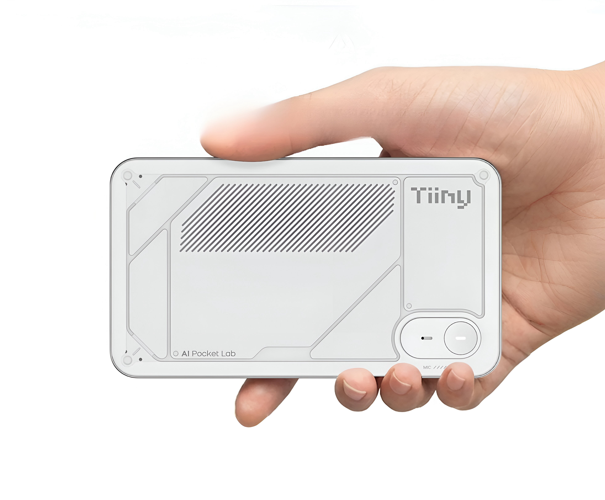

# Tiiny Pocket — community know-how

A Tiiny Pocket in the wild — note the USB-C → Ethernet adapter in the second USB-C port, which puts the box straight on the LAN (see [networking](docs/en/networking.md)).

Unofficial, community-gathered notes on the **Tiiny Pocket** local AI box (model *Tiiny z01*):
hardware internals, the on-device HTTP API, networking, the official CLI, SSH, models, services
and connectors. Collected from hands-on testing plus other community projects.

> **Not affiliated** with Tiiny / dev.tiiny.ai. No warranty — commands here can change device state.
> Nothing here contains secrets; replace every `<TOKEN>` / `<ip>` placeholder with your own values.
> Verified against **TiinyOS firmware 0.1.39** (desktop app 1.0.3), November 2026.

🇨🇿 Česká verze níže / Czech version below.

---

## What is Tiiny?

**Tiiny Pocket** is a compact, self-contained **local AI appliance** — a small box you keep on your
desk that runs modern AI models **entirely on-device**, with no cloud inference. It pairs an ARM SoC
with a **discrete NPU and 80 GB of memory**, so it can host large language models (chat up to ~120B
MoE), image generation, speech-to-text, embeddings and more, all locally.

You talk to it over plain **HTTP on your own network** — it speaks OpenAI-, Ollama- and
Anthropic-compatible APIs — so existing tools and chat front-ends connect to it unchanged. Because the
models and your data never leave the box, it's aimed at **private, offline, always-available** AI: a
personal inference server the size of a small gadget. Set-up and OS updates are driven by the TiinyOS
desktop app; everything else is the API documented here.

This repo is the **community know-how** that the official quick start doesn't cover — how the box is
built, every API surface, networking (including the USB-C Ethernet trick), models, the CLI, SSH, and the
real-world upgrade process.

---

## Contents

| Topic | Doc |
|---|---|
| Hardware internals | [docs/en/hardware.md](docs/en/hardware.md) |
| Networking & access (Wi-Fi, USB, USB-Ethernet, discovery, ports) | [docs/en/networking.md](docs/en/networking.md) |
| HTTP API (OpenAI-compatible + native) | [docs/en/api.md](docs/en/api.md) |
| Ollama & Anthropic compatible APIs | [docs/en/ollama-anthropic-api.md](docs/en/ollama-anthropic-api.md) |
| Models & custom model import | [docs/en/models.md](docs/en/models.md) |
| CLI & SSH | [docs/en/cli-and-ssh.md](docs/en/cli-and-ssh.md) |
| Services (apps) & connectors (MCP) | [docs/en/services-and-connectors.md](docs/en/services-and-connectors.md) |
| OTA upgrade — the field guide (what quick start skips) | [docs/en/ota-upgrade.md](docs/en/ota-upgrade.md) |
| Security — observations & open concerns (speculative) | [docs/en/security.md](docs/en/security.md) |
| Troubleshooting | [docs/en/troubleshooting.md](docs/en/troubleshooting.md) |
| Related community projects | [docs/en/community-projects.md](docs/en/community-projects.md) |
| Example scripts (speech-to-text, song gen, curl) | [examples/](examples/) |

## In one minute

- The box runs an **nginx :80 + FastAPI** server. **Everything is HTTP on port 80**; the service is
  selected by the `Host` header (`api.tiiny`, `ollama.api.tiiny`, `anthropic.api.tiiny`, …).
- Every request carries `Authorization: Bearer <TOKEN>` (the API key from the TiinyOS app →
  *Settings → API access*).
- Reach it over **Wi-Fi**, over **USB-C** (gadget to a host), or by plugging a **USB-C Ethernet
  adapter into the second USB-C port** so the box joins your LAN directly.
- There is **no web admin UI and no official shell**. An SSH server listens on **port 3588** (key-only);
  community tooling can enroll your own key.
- Models load on demand; the box does roughly **one inference at a time**.

## Acknowledgements

Built on the work of the wider Tiiny community. Full credits and links to every repo we cite or drew
inspiration from are in [docs/en/community-projects.md](docs/en/community-projects.md).

## Official links

- **tiiny.ai** — <https://tiiny.ai> — the official product site.
- **dev.tiiny.ai** — <https://dev.tiiny.ai> — the developer portal (API docs, CLI).

## License

[MIT](LICENSE). These are independent community notes, not affiliated with or endorsed by Tiiny AI;
"Tiiny" and product names belong to their owner.

---
---

# 🇨🇿 Tiiny Pocket — komunitní know-how

Neoficiální, komunitně sesbírané poznámky k lokálnímu AI boxu **Tiiny Pocket** (model *Tiiny z01*):
hardware uvnitř, HTTP API zařízení, síť, oficiální CLI, SSH, modely, služby a konektory.
Sesbíráno z vlastního testování a z dalších komunitních projektů.

> **Bez vazby** na Tiiny / dev.tiiny.ai. Bez záruky — příkazy zde mohou měnit stav zařízení.
> Nic zde neobsahuje tajemství; každý zástupný `<TOKEN>` / `<ip>` nahraď vlastními hodnotami.
> Ověřeno proti **TiinyOS firmware 0.1.39** (desktop app 1.0.3), listopad 2026.

## Co je Tiiny?

**Tiiny Pocket** je kompaktní, soběstačné **lokální AI zařízení** — malý box na stole, který provozuje
moderní AI modely **kompletně v zařízení**, bez cloudové inference. Spojuje ARM SoC s **diskrétním NPU a
80 GB paměti**, takže zvládne velké jazykové modely (chat až ~120B MoE), generování obrázků, přepis
řeči, embeddingy a další — všechno lokálně.

Komunikuješ s ním přes obyčejné **HTTP ve vlastní síti** — mluví API kompatibilním s OpenAI, Ollama i
Anthropic — takže se k němu stávající nástroje a chatovací frontendy připojí beze změny. Protože modely
ani tvoje data box neopouštějí, míří na **soukromou, offline, stále dostupnou** AI: osobní inferenční
server velikosti drobného gadgetu. Instalaci a OS updaty řídí desktopová aplikace TiinyOS; všechno
ostatní je API popsané tady.

Tohle repo je **komunitní know-how**, které oficiální quick start nepokrývá — jak je box postavený,
všechna API, síť (včetně triku s USB-C Ethernetem), modely, CLI, SSH a reálný průběh upgradu.

## Obsah

| Téma | Dokument |
|---|---|
| Hardware uvnitř | [docs/cs/hardware.md](docs/cs/hardware.md) |
| Síť a přístup (Wi-Fi, USB, USB-Ethernet, discovery, porty) | [docs/cs/networking.md](docs/cs/networking.md) |
| HTTP API (OpenAI-kompatibilní + nativní) | [docs/cs/api.md](docs/cs/api.md) |
| Ollama a Anthropic kompatibilní API | [docs/cs/ollama-anthropic-api.md](docs/cs/ollama-anthropic-api.md) |
| Modely a import vlastních modelů | [docs/cs/models.md](docs/cs/models.md) |
| CLI a SSH | [docs/cs/cli-and-ssh.md](docs/cs/cli-and-ssh.md) |
| Služby (aplikace) a konektory (MCP) | [docs/cs/services-and-connectors.md](docs/cs/services-and-connectors.md) |
| OTA upgrade — terénní průvodce (co quick start vynechává) | [docs/cs/ota-upgrade.md](docs/cs/ota-upgrade.md) |
| Bezpečnost — pozorování a obavy (spekulativní) | [docs/cs/security.md](docs/cs/security.md) |
| Řešení potíží | [docs/cs/troubleshooting.md](docs/cs/troubleshooting.md) |
| Související komunitní projekty | [docs/cs/community-projects.md](docs/cs/community-projects.md) |
| Ukázkové skripty (přepis řeči, generování písní, curl) | [examples/](examples/) |

## V jedné minutě

- Box provozuje server **nginx :80 + FastAPI**. **Vše běží přes HTTP na portu 80**; služba se vybírá
  hlavičkou `Host` (`api.tiiny`, `ollama.api.tiiny`, `anthropic.api.tiiny`, …).
- Každý požadavek nese `Authorization: Bearer <TOKEN>` (API klíč z aplikace TiinyOS →
  *Settings → API access*).
- Dostaneš se tam přes **Wi-Fi**, přes **USB-C** (gadget do hostitele) nebo zapojením
  **USB-C Ethernet adaptéru do druhého USB-C portu**, čímž se box připojí přímo do tvé LAN.
- **Není webové admin rozhraní ani oficiální shell**. SSH server poslouchá na **portu 3588** (jen klíč);
  komunitní nástroje umí přidat vlastní klíč.
- Modely se načítají na vyžádání; box zvládá zhruba **jednu inferenci naráz**.

## Poděkování

Staví na práci širší Tiiny komunity. Kompletní credits a odkazy na každé repo, které citujeme nebo jímž
jsme se inspirovali, jsou v [docs/cs/community-projects.md](docs/cs/community-projects.md).

## Oficiální odkazy

- **tiiny.ai** — <https://tiiny.ai> — oficiální produktový web.
- **dev.tiiny.ai** — <https://dev.tiiny.ai> — vývojářský portál (API dokumentace, CLI).

## Licence

[MIT](LICENSE). Jde o nezávislé komunitní poznámky, bez vazby na Tiiny AI a bez jejich podpory; „Tiiny“
a názvy produktů patří jejich vlastníkovi.
